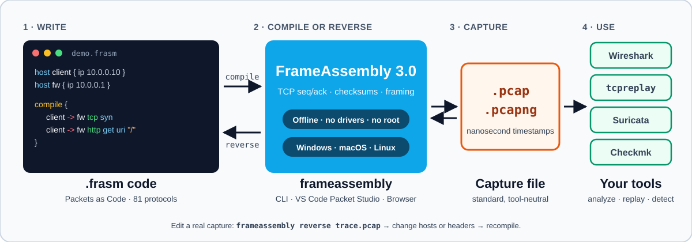
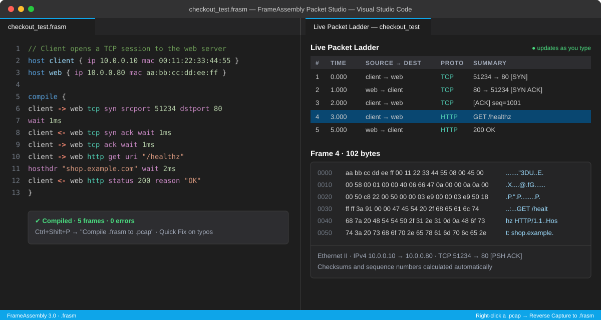

# FrameAssembly Documentation

[← Main README](../README.md) • [Getting Started](01_getting_started.md) • [Use-Case Cookbook](02_use_cases.md) • [Scenario Index](../examples/README.md)

Pick what broke this morning, or hit Ctrl+F in the 81-protocol table below. Everything here covers FrameAssembly 3.0: write `.frasm` code, compile it into `.pcap` / `.pcapng` captures, or reverse an existing capture back into code you can edit.

## Start With What Is on Fire

| If your day looks like this | Read this first | Then try |
| :--- | :--- | :--- |
| **Checkmk, Zabbix or PRTG never paged anyone** | [SNMPv1, v2c & v3](06_l7_snmp.md) | [Infrastructure & telemetry](07_l7_infra_and_telemetry.md), [Use-Case Cookbook](02_use_cases.md) |
| **The firewall team says the box dropped nothing** | [Getting Started](01_getting_started.md) | [Layer 2](03_l2_protocols.md), [Layer 4](05_l4_transports.md), [Topologies & dual-stack](11_topologies_and_dual_stack.md) |
| **A Suricata or Zeek rule needs proof, not hope** | [Use-Case Cookbook](02_use_cases.md) | [Web & cloud](08_l7_web_and_cloud.md), [Mail, auth & databases](09_l7_mail_auth_storage_db.md) |
| **Routing or EVPN lab you do not want to build** | [Layer 3 routing & tunnels](04_l3_protocols.md) | [Topologies & dual-stack](11_topologies_and_dual_stack.md) |
| **Industrial gear nobody is allowed to poke** | [Industrial OT](10_l7_industrial_ot.md) | [Layer 4 transports](05_l4_transports.md) |
| **CI needs a capture fixture** | [Compiler internals](13_for_nerds.md) | [`.frasm` specification](12_frasm_specification.md) |
| **An AI assistant keeps inventing keywords** | [Getting Started: the AI prompt](01_getting_started.md#8-generating-frasm-code-with-ai-assistants-copy-paste-prompt) | [`.frasm` specification](12_frasm_specification.md) |

## Three Ways to Run It

1. **Browser Playground:** [frameassembly.ai.studio](https://frameassembly.ai.studio/) needs nothing installed.
2. **VS Code Packet Studio:** `code --install-extension SteveWinschel.frameassembly-vscode` puts a live Packet Ladder next to your code.
3. **Command line:** the install table in [Getting Started](01_getting_started.md#1-install-frameassembly) covers Windows `install.ps1`, macOS and Linux `install.sh`, Homebrew, Scoop, `.deb`, and plain downloads.

## The 13 Guides

| Guide | What is inside |
| :--- | :--- |
| [Getting Started](01_getting_started.md) | Install, first capture, MAC shortcuts, TCP without sequence math, the AI prompt |
| [Use-Case Cookbook](02_use_cases.md) | Copy-paste recipes for SNMPv3 traps, Shadow IT, firewall ACLs, VLAN trunks, OT and `.pcap` scrubbing |
| [Layer 2](03_l2_protocols.md) | `arp`, `vlan`, `qinq`, `lldp`, `stp`, `lacp`, `eapol`, `mpls` |
| [Layer 3](04_l3_protocols.md) | ICMP, multicast, tunnels, VPNs and routing protocols |
| [Layer 4](05_l4_transports.md) | `tcp`, `udp`, `sctp` and TCP options |
| [SNMP](06_l7_snmp.md) | `snmp1`, `snmp2`, `snmp3` with USM authentication and encryption |
| [Infrastructure & telemetry](07_l7_infra_and_telemetry.md) | DNS, DHCP, NTP, PTP, RADIUS, TACACS+, syslog, NetFlow, IPFIX, sFlow |
| [Web & cloud](08_l7_web_and_cloud.md) | HTTP, HTTP/2, gRPC, WebSocket, TLS, QUIC, SSH, SIP, RTP and friends |
| [Mail, auth, storage & databases](09_l7_mail_auth_storage_db.md) | SMTP, IMAP, POP3, Kerberos, LDAP, SMB, NFS, Redis, MySQL, PostgreSQL, MQTT, AMQP |
| [Industrial OT](10_l7_industrial_ot.md) | Modbus, DNP3, S7comm, EtherNet/IP, BACnet, OPC UA |
| [Topologies & dual-stack](11_topologies_and_dual_stack.md) | Multi-host scenarios, EVPN-VXLAN, 802.1X campus, IPv4 and IPv6 reuse |
| [`.frasm` specification](12_frasm_specification.md) | File format, media type, and how `.frasm` differs from `.fasm` |
| [Compiler internals](13_for_nerds.md) | Pipeline, Rust library API and formal grammars |

Sample files by theme live in the [scenario index](../examples/README.md).

## Find a Protocol (All 81)

Search for the protocol name. Each example is one packet statement: declare two `host` entries, paste the line inside `compile { ... }`, and you have a capture. The guide link has every option.

| Layer | Protocol | What it covers | Example statement | Full guide |
| :--- | :--- | :--- | :--- | :--- |
| L2 | `arp` | Address resolution, gratuitous ARP | `host -> gw arp request` | [guide](03_l2_protocols.md) |
| L2 | `vlan` | 802.1Q tags on any frame | `c -> srv vlan 100 pcp 2 ssh banner "SSH-2.0-OpenSSH_9.6"` | [guide](03_l2_protocols.md) |
| L2 | `qinq` | 802.1ad double tags | `bldg -> core qinq 600 innervlan 61 dns qname "arxiv.org"` | [guide](03_l2_protocols.md) |
| L2 | `lldp` | Neighbor discovery | `worker -> leaf lldp chassisid "k8s-worker-gpu-21" portid "bond0"` | [guide](03_l2_protocols.md) |
| L2 | `stp` | Spanning tree and RSTP BPDUs | `a -> b stp rstp forwarddelay 4 flags 60` | [guide](03_l2_protocols.md) |
| L2 | `lacp` | Port-channel negotiation | `srv -> sw lacp actorkey 100 partnerkey 200` | [guide](03_l2_protocols.md) |
| L2 | `eapol` | 802.1X authentication | `src -> dst eapol type start` | [guide](03_l2_protocols.md) |
| L2 | `mpls` | MPLS label stacks | `a -> b mpls 2048 exp 0 bos 1 mplsttl 64 udp payload "6pe_ipv6_payload"` | [guide](03_l2_protocols.md) |
| L3 | `icmp` | Ping and error messages | `rtr -> host icmp timeexceeded code 0` | [guide](04_l3_protocols.md) |
| L3 | `ndp` | IPv6 neighbor discovery | `src -> dst ndp neighborsolicit target 2001:db8::20` | [guide](04_l3_protocols.md) |
| L3 | `igmp` | IPv4 multicast membership | `w1 -> g1 igmp report group 239.50.1.1` | [guide](04_l3_protocols.md) |
| L3 | `mld` | IPv6 multicast listener discovery | `q -> grp mld query maxrespdelay 10000` | [guide](04_l3_protocols.md) |
| L3 | `gre` | GRE tunnels | `a -> b gre grekey 12345 greseq 1` | [guide](04_l3_protocols.md) |
| L3 | `vxlan` | VXLAN overlays (EVPN) | `a -> b vxlan vni 50000` | [guide](04_l3_protocols.md) |
| L3 | `geneve` | Geneve overlays | `g1 -> g2 geneve vni 20000` | [guide](04_l3_protocols.md) |
| L3 | `ipsec` | IPsec ESP/AH wrapper | `a -> b ipsec spi 16384 seq 1` | [guide](04_l3_protocols.md) |
| L3 | `esp` | Encapsulating Security Payload | `a -> b esp spi 10001 seq 1` | [guide](04_l3_protocols.md) |
| L3 | `ah` | Authentication Header | `c -> s ah spi 12000 seq 1` | [guide](04_l3_protocols.md) |
| L3 | `ikev2` | IKEv2 key exchange | `init -> resp ikev2 exchange sainit` | [guide](04_l3_protocols.md) |
| L3 | `wireguard` | WireGuard handshake and data | `a -> b wireguard type initiation` | [guide](04_l3_protocols.md) |
| L3 | `ospf` | OSPF hello, database descriptions | `r1 -> r2 ospf hello areaid 0` | [guide](04_l3_protocols.md) |
| L3 | `bgp` | BGP open, keepalive, updates | `a -> b bgp open asn 65001 holdtime 180 bgpid 10.0.0.1` | [guide](04_l3_protocols.md) |
| L3 | `rip` | RIP requests and responses | `br -> dr rip request` | [guide](04_l3_protocols.md) |
| L3 | `vrrp` | VRRP virtual router adverts | `p -> b vrrp vrid 1 priority 120` | [guide](04_l3_protocols.md) |
| L3 | `hsrp` | Cisco HSRP hellos | `p -> b hsrp group 1 priority 110` | [guide](04_l3_protocols.md) |
| L3 | `pim` | PIM multicast routing | `r1 -> r2 pim hello` | [guide](04_l3_protocols.md) |
| L3 | `bfd` | Fast failure detection | `a -> b bfd state 3 mydisc 100 yourdisc 200` | [guide](04_l3_protocols.md) |
| L3 | `openflow` | OpenFlow controller traffic | `c -> s openflow type hello` | [guide](04_l3_protocols.md) |
| L4 | `tcp` | Stateful TCP (automatic seq/ack) | `c -> s tcp syn srcport 45000 dstport 80` | [guide](05_l4_transports.md) |
| L4 | `udp` | UDP datagrams | `client -> server udp dstport 53 payload "query"` | [guide](05_l4_transports.md) |
| L4 | `sctp` | SCTP chunks | `a -> b sctp chunk init vtag 0` | [guide](05_l4_transports.md) |
| L7 | `snmp1` | SNMPv1 get, set, traps | `agent -> nms snmp1 trap community "chassis_ro" enterprise 1.3.6.1.4.1.9.9.13` | [guide](06_l7_snmp.md) |
| L7 | `snmp2` | SNMPv2c get, getbulk, traps, informs | `agent -> collector snmp2 trap community "public" reqid 6001 oid 1.3.6.1.6.3.1.1.5.3` | [guide](06_l7_snmp.md) |
| L7 | `snmp3` | SNMPv3 with SHA-2 auth and AES/DES privacy | `nms -> pe snmp3 get user "vrf_auditor" auth sha256 "VrfAuthKey!" priv aes "VrfPrivKey!" varbind 1.3.6.1.2.1.1.3.0 null` | [guide](06_l7_snmp.md) |
| L7 | `dns` | DNS queries and responses | `b -> d dns query txid 0x5002 qname "edge.akamaiedge.net" qtype "a"` | [guide](07_l7_infra_and_telemetry.md) |
| L7 | `mdns` | Multicast DNS | `w -> g mdns query qname "printer.local" qtype a` | [guide](07_l7_infra_and_telemetry.md) |
| L7 | `dhcp` | DHCPv4 and DHCPv6 | `c -> s dhcp discover chaddr 00:11:22:33:44:55` | [guide](07_l7_infra_and_telemetry.md) |
| L7 | `ntp` | Time sync | `c -> s ntp mode 3 stratum 2` | [guide](07_l7_infra_and_telemetry.md) |
| L7 | `ptp` | Precision Time Protocol | `c -> s ptp delayreq seqid 101 domain 0` | [guide](07_l7_infra_and_telemetry.md) |
| L7 | `radius` | RADIUS auth and accounting | `c -> s radius accessrequest user "operator"` | [guide](07_l7_infra_and_telemetry.md) |
| L7 | `tacacs` | TACACS+ authentication, accounting | `tacacs_v6 -> rtr_v6 tacacs authen sessionid 6001 payload "AUTHEN_STATUS_PASS"` | [guide](07_l7_infra_and_telemetry.md) |
| L7 | `syslog` | Syslog events | `c -> s syslog facility 2 severity 6` | [guide](07_l7_infra_and_telemetry.md) |
| L7 | `netflow` | NetFlow records | `c -> s netflow srcip 10.1.1.50 dstip 10.2.2.50 proto 17 packets 12 octets 1500` | [guide](07_l7_infra_and_telemetry.md) |
| L7 | `ipfix` | IPFIX records | `rtr -> col ipfix domainid 4001 srcip 198.51.100.25 dstip 203.0.113.80 proto 6` | [guide](07_l7_infra_and_telemetry.md) |
| L7 | `sflow` | sFlow samples | `c -> s sflow agentip 10.0.0.1 subagentid 5 samples 25` | [guide](07_l7_infra_and_telemetry.md) |
| L7 | `tftp` | TFTP transfers | `c -> s tftp ack block 3` | [guide](08_l7_web_and_cloud.md) |
| L7 | `ftp` | FTP commands | `c -> s ftp cmd "PWD"` | [guide](08_l7_web_and_cloud.md) |
| L7 | `ssh` | SSH banners and key exchange | `c -> s ssh banner "SSH-2.0-OpenSSH_9.5p1 Debian-1"` | [guide](08_l7_web_and_cloud.md) |
| L7 | `telnet` | Telnet sessions | `c -> s telnet payload "show version\r\n"` | [guide](08_l7_web_and_cloud.md) |
| L7 | `http` | HTTP/1.1 requests and responses | `c -> s http method "GET" uri "/healthz"` | [guide](08_l7_web_and_cloud.md) |
| L7 | `http2` | HTTP/2 frames | `c -> s http2 headers streamid 5` | [guide](08_l7_web_and_cloud.md) |
| L7 | `grpc` | gRPC calls | `c -> s grpc service "UserService" method "GetUserProfile"` | [guide](08_l7_web_and_cloud.md) |
| L7 | `websocket` | WebSocket frames | `c -> s websocket opcode "ping" finbit 1` | [guide](08_l7_web_and_cloud.md) |
| L7 | `tls` | TLS handshakes and alerts (SNI, ALPN) | `c -> s tls clienthello sni "www.example.com"` | [guide](08_l7_web_and_cloud.md) |
| L7 | `quic` | QUIC packets | `c -> s quic short dcid 0x05060708` | [guide](08_l7_web_and_cloud.md) |
| L7 | `stun` | STUN binding requests | `c -> s stun bindingrequest software "SIP-Agent-3.0"` | [guide](08_l7_web_and_cloud.md) |
| L7 | `sip` | SIP signaling | `c -> s sip ack uri "sip:9999@10.14.6.1" callid "err-404" cseq 1` | [guide](08_l7_web_and_cloud.md) |
| L7 | `rtp` | RTP media streams | `c -> s rtp pt 0 ssrc 0xaabbccdd timestamp 160` | [guide](08_l7_web_and_cloud.md) |
| L7 | `rtsp` | RTSP camera control | `c -> s rtsp options uri "rtsp://camera.local/live" cseq 1` | [guide](08_l7_web_and_cloud.md) |
| L7 | `ssdp` | UPnP discovery | `s -> m ssdp msearch st "upnp:rootdevice"` | [guide](08_l7_web_and_cloud.md) |
| L7 | `whois` | WHOIS lookups | `c -> s whois query domain "AS3333"` | [guide](08_l7_web_and_cloud.md) |
| L7 | `smtp` | Mail submission and relay | `c -> s smtp mailfrom param "alice@corp.net"` | [guide](09_l7_mail_auth_storage_db.md) |
| L7 | `imap` | IMAP mailbox access | `c -> s imap tag "A04" cmd "NOOP"` | [guide](09_l7_mail_auth_storage_db.md) |
| L7 | `pop3` | POP3 mailbox access | `c -> s pop3 cmd "STAT"` | [guide](09_l7_mail_auth_storage_db.md) |
| L7 | `kerberos` | Kerberos tickets | `c -> dc kerberos asreq realm "CORP.LOCAL"` | [guide](09_l7_mail_auth_storage_db.md) |
| L7 | `ldap` | LDAP directory queries | `c -> s ldap unbindreq msgid 3` | [guide](09_l7_mail_auth_storage_db.md) |
| L7 | `smb` | SMB file shares | `c -> s smb command "negotiate"` | [guide](09_l7_mail_auth_storage_db.md) |
| L7 | `nfs` | NFS file access | `c -> s nfs proc lookup path "/exports/data"` | [guide](09_l7_mail_auth_storage_db.md) |
| L7 | `redis` | Redis commands | `c -> s redis cmd "PING"` | [guide](09_l7_mail_auth_storage_db.md) |
| L7 | `memcached` | Memcached commands | `c -> n memcached cmd "stats"` | [guide](09_l7_mail_auth_storage_db.md) |
| L7 | `mysql` | MySQL queries | `mgr -> srv mysql sql "SELECT 1"` | [guide](09_l7_mail_auth_storage_db.md) |
| L7 | `postgres` | PostgreSQL startup and queries | `c -> s postgres startup db "analytics"` | [guide](09_l7_mail_auth_storage_db.md) |
| L7 | `mqtt` | MQTT messaging | `c -> s mqtt puback pktid 51` | [guide](09_l7_mail_auth_storage_db.md) |
| L7 | `coap` | CoAP for IoT | `c -> s coap con get uripath "/telemetry"` | [guide](09_l7_mail_auth_storage_db.md) |
| L7 | `amqp` | AMQP brokers | `p -> b amqp channelopen channel 1` | [guide](09_l7_mail_auth_storage_db.md) |
| L7 | `modbus` | Modbus/TCP | `m -> s modbus func readholdingregisters addr 100 count 10` | [guide](10_l7_industrial_ot.md) |
| L7 | `bacnet` | BACnet building automation | `c -> s bacnet whois` | [guide](10_l7_industrial_ot.md) |
| L7 | `dnp3` | DNP3 SCADA | `m -> r dnp3 func read` | [guide](10_l7_industrial_ot.md) |
| L7 | `s7comm` | Siemens S7comm | `pg -> plc s7comm func readvar` | [guide](10_l7_industrial_ot.md) |
| L7 | `ethernetip` | EtherNet/IP | `s -> a ethernetip cmd listidentity` | [guide](10_l7_industrial_ot.md) |
| L7 | `opcua` | OPC UA | `c -> s opcua msgtype hel` | [guide](10_l7_industrial_ot.md) |

## Four Rules You Will Use Every Day

* Built-in keywords are lowercase with no underscores or hyphens: `echorequest`, `clienthello`, `hosthdr`. Your own `host` and `flow` names can use letters, digits, `_` and `-`.
* One statement writes one packet. In the examples above, the arrow direction decides who sends: left to right is forward, right to left is the reply.
* Ports, sequence numbers and checksums follow along automatically.
* `frameassembly show file.frasm` previews the packet ladder, `frameassembly file.frasm` writes the capture, and `frameassembly reverse capture.pcap` turns a capture back into code.
