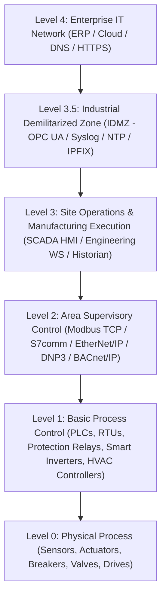

# FrameAssembly Layer 7 Industrial Control Systems (ICS), SCADA & OT Protocols Reference

This reference guide provides an exhaustive architectural and wire-encoding specification for all **6 Layer 7 Industrial Control Systems (ICS), Building Automation, Smart Grid Substation, and Factory Automation Operational Technology (OT) protocols** implemented in [**FrameAssembly**](https://github.com/SteveWinschel/FrameAssembly) (`src/parser/l7/` and `src/builders/l7/`):

1. **Modbus TCP (`MODBUS` — Port 502)** — Modbus Application Protocol v1.1b3 (`MBAP` 7-byte header + Function Code PDU for holding/input registers, coils, and discrete inputs)
2. **BACnet/IP (`BACNET` — UDP Port 47808 / `0xBAC0`)** — ANSI/ASHRAE Standard 135 (`BVLC` Virtual Link Control + `NPDU` Network Layer + `APDU` Application Layer for `WHO_IS`, `I_AM`, `READ_PROPERTY`, `WRITE_PROPERTY`)
3. **Distributed Network Protocol v3 (`DNP3` — Port 20000)** — IEEE Standard 1815-2012 (FT3 Data Link Frame `0x0564` with per-block IEEE 1815 CRC-16 + Pseudo-Transport Header + Application Layer Object Headers)
4. **Siemens S7 Communication (`S7COMM` — TCP Port 102)** — SIMATIC S7-300/400/1200/1500 PLC protocol (`RFC 1006 TPKT` v3 + `ISO 8073 COTP` DT Data + `0x32` S7 PDU Header, Parameter Block, and Data Block)
5. **ODVA EtherNet/IP & CIP (`ETHERNETIP` — TCP Port 44818 / UDP Port 2222)** — Common Industrial Protocol (`CIP`) 24-byte Encapsulation Header + Command-Specific Data (`REGISTER_SESSION`, `LIST_IDENTITY`, `SEND_RR_DATA`, `SEND_UNIT_DATA`) and EPATH Logical Segments (`Class`, `Instance`, `Attribute`)
6. **OPC Unified Architecture (`OPCUA` — TCP Port 4840)** — IEC 62541 OPC UA Binary Conversation Protocol (`HEL`, `ACK`, `ERR`, `OPN`, `CLO`, `MSG` chunks with Security Header, Sequence Header, and NodeId encoding)

---

## 1. Quick Reference Matrix (Industrial / OT / SCADA Protocols)

| Protocol | Keyword | Default Transport | Industrial Standard | Supported Sub-Keywords & Modifiers |
| :--- | :--- | :--- | :--- | :--- |
| **Modbus TCP** | `MODBUS` | TCP `502` | Modbus Application Protocol v1.1b3 | `FUNC "<READ_COILS\|READ_DISCRETE_INPUTS\|READ_HOLDING_REGISTERS\|READ_INPUT_REGISTERS\|WRITE_SINGLE_COIL\|WRITE_SINGLE_REGISTER\|WRITE_MULTIPLE_REGISTERS>"`, `TXID <u16>`, `PROTO_ID <u16>`, `UNITID <u8>`, `ADDR <u16>`, `COUNT <u16>`, `IS_RESPONSE` |
| **BACnet/IP** | `BACNET` | UDP `47808` (`0xBAC0`) | ANSI/ASHRAE 135 | `WHO_IS`, `I_AM`, `READ_PROPERTY`, `WRITE_PROPERTY`, `PDU_TYPE <u8>`, `SERVICE <u8>`, `INVOKE_ID <u8>`, `OBJECT_TYPE <u16\|"<str>">`, `OBJECT_INSTANCE <u32>`, `PROPERTY_ID <u32\|"<str>">`, `VALUE <u32>` |
| **DNP3** | `DNP3` | TCP `20000` | IEEE 1815-2012 | `FUNC "<CONFIRM\|READ\|WRITE\|SELECT\|OPERATE\|DIRECT_OPERATE\|RESPONSE\|UNSOLICITED_RESPONSE>"`, `CTRL <u8>`, `SRC <u16>`, `DST <u16>`, `SEQ <u8>`, `GROUP <u8>`, `VARIATION <u8>`, `CRC <u16>` |
| **Siemens S7comm** | `S7COMM` | TCP `102` | Siemens S7 / RFC 1006 / ISO 8073 | `ROSCTR "<JOB\|ACK\|ACK_DATA\|USERDATA>"`, `FUNC "<SETUP_COMM\|READ_VAR\|WRITE_VAR\|PLC_CONTROL>"`, `PDU_REF <u16>`, `AREA <u8\|"<str>">`, `DB_NUM <u16>`, `OFFSET <u32>`, `COUNT <u16>` |
| **EtherNet/IP (CIP)** | `ETHERNETIP` | TCP `44818` | ODVA EtherNet/IP & CIP | `CMD "<NOP\|LIST_SERVICES\|LIST_IDENTITY\|LIST_INTERFACES\|REGISTER_SESSION\|UNREGISTER_SESSION\|SEND_RR_DATA\|SEND_UNIT_DATA>"`, `SESSION_HANDLE <u32>`, `STATUS <u32>`, `CONTEXT "<str>"`, `CIP_SERVICE <u8>`, `CIP_CLASS <u16>`, `CIP_INSTANCE <u16>`, `CIP_ATTR <u16>` |
| **OPC UA Binary** | `OPCUA` | TCP `4840` | IEC 62541 | `MSG_TYPE "<HEL\|ACK\|ERR\|OPN\|CLO\|MSG>"`, `CHUNK_TYPE "<F\|C\|A>"`, `SECURE_CHANNEL_ID <u32>`, `TOKEN_ID <u32>`, `SEQ_NUM <u32>`, `REQID <u32>`, `ENDPOINT_URL "<str>"` (`ENDPOINT "<str>"`), `NODE_ID "<str>"` (`NODE "<str>"`) |

---

## 2. Purdue Enterprise Reference Architecture (PERA / IEC 62443) Mapping

In industrial cybersecurity and OT network engineering (ISA-95 / IEC 62443), industrial protocols operate across distinct Purdue Levels:



FrameAssembly allows security researchers, Intrusion Detection System (IDS) engineers (Suricata, Zeek, Snort), and industrial firewall architects to synthesize realistic multi-zone Purdue Level 1–3.5 traffic in a single `.fasm` file, combining Layer 2 IEEE 802.1Q VLAN priority tagging (`PCP 6` for industrial control), Layer 4 TCP/UDP transport, and Layer 7 OT application headers.

---

## 3. Modbus TCP (`MODBUS` — Port 502)

### 3.1 Wire Format & MBAP Header Architecture
Modbus TCP (`src/builders/l7/modbus.rs`) encapsulates a standard Modbus Protocol Data Unit (`PDU`) inside a 7-byte **Modbus Application Protocol (`MBAP`)** header over TCP port `502`:

```text
 0                   1                   2                   3
 0 1 2 3 4 5 6 7 8 9 0 1 2 3 4 5 6 7 8 9 0 1 2 3 4 5 6 7 8 9 0 1
+-+-+-+-+-+-+-+-+-+-+-+-+-+-+-+-+-+-+-+-+-+-+-+-+-+-+-+-+-+-+-+-+
|        Transaction ID         |      Protocol ID (0x0000)     |
+-+-+-+-+-+-+-+-+-+-+-+-+-+-+-+-+-+-+-+-+-+-+-+-+-+-+-+-+-+-+-+-+
|            Length             |    Unit ID    | Function Code |
+-+-+-+-+-+-+-+-+-+-+-+-+-+-+-+-+-+-+-+-+-+-+-+-+-+-+-+-+-+-+-+-+
|           Starting Address / Register Data Payload ...        |
+-+-+-+-+-+-+-+-+-+-+-+-+-+-+-+-+-+-+-+-+-+-+-+-+-+-+-+-+-+-+-+-+
```

- **Transaction ID (`TXID <u16>`)**: 16-bit big-endian identifier matching requests and responses (default: `1`).
- **Protocol ID (`PROTO_ID <u16>`)**: 16-bit big-endian protocol identifier; always `0x0000` for Modbus TCP.
- **Length**: 16-bit big-endian byte count of all following bytes (`1 (Unit ID) + pdu.len()`). Automatically computed by `build_modbus_payload`.
- **Unit ID (`UNITID <u8>`)**: 8-bit slave/unit identifier addressing downstream serial RTU devices behind a Modbus TCP gateway (default: `1`).
- **Function Code (`FUNC "<name>"`)**:
  - `"READ_COILS"` (`0x01`): Read contiguous discrete output coils (`00001`–`09999`).
  - `"READ_DISCRETE_INPUTS"` (`0x02`): Read contiguous discrete input contacts (`10001`–`19999`).
  - `"READ_HOLDING_REGISTERS"` (`0x03`): Read contiguous 16-bit read/write holding registers (`40001`–`49999`).
  - `"READ_INPUT_REGISTERS"` (`0x04`): Read contiguous 16-bit analog input registers (`30001`–`39999`).
  - `"WRITE_SINGLE_COIL"` (`0x05`): Force a single coil ON (`0xFF00`) or OFF (`0x0000`).
  - `"WRITE_SINGLE_REGISTER"` (`0x06`): Write a single 16-bit holding register.
  - `"WRITE_MULTIPLE_REGISTERS"` (`0x10` / `16`): Write multiple contiguous 16-bit holding registers.
- **Directionality (`IS_RESPONSE`)**:
  - When `IS_RESPONSE` is omitted (Request PDU): encodes `[ADDR (2B BE), COUNT (2B BE)]` for Read/Write functions.
  - When `IS_RESPONSE` is specified (Response PDU): encodes `[ByteCount (1B), RegisterValues...]` for Read functions or echoes `[ADDR (2B BE), Value/Count (2B BE)]` for Write functions.

### 3.2 Complete Grammar & Modifiers (`MODBUS`)

| Modifier | Parameter Type | Default | Wire Encoding Details |
| :--- | :--- | :--- | :--- |
| `FUNC "<str>"` | String | `"READ_HOLDING_REGISTERS"` | Function code name (`"READ_COILS"`, `"READ_DISCRETE_INPUTS"`, `"READ_HOLDING_REGISTERS"`, `"READ_INPUT_REGISTERS"`, `"WRITE_SINGLE_COIL"`, `"WRITE_SINGLE_REGISTER"`, `"WRITE_MULTIPLE_REGISTERS"`). |
| `TXID <u16>` | `u16` | `1` | 2-byte big-endian MBAP Transaction Identifier. |
| `PROTO_ID <u16>` | `u16` | `0` | 2-byte big-endian MBAP Protocol Identifier (`0x0000`). |
| `UNITID <u8>` | `u8` | `1` | 1-byte Slave/Unit Identifier. |
| `ADDR <u16>` | `u16` | `0` | 2-byte big-endian starting register/coil address. |
| `COUNT <u16>` | `u16` | `1` | 2-byte big-endian quantity of registers/coils to read or write. |
| `IS_RESPONSE` | Flag | `false` | Synthesizes a PLC Slave Response PDU rather than an HMI Master Request PDU. |

### 3.3 Compilable Example (`MODBUS`)

```frameassembly
// PROMPT: SCADA HMI polling a PLC over Modbus TCP for holding registers, input registers, coils, and writing a single register setpoint.
// TOKENS: HOST, IP, MAC, FLOW, ->, <-, MODBUS, FUNC, TXID, UNITID, ADDR, COUNT, IS_RESPONSE, WAIT, COMPILE

// INSTRUCTION: Define the Level 3 SCADA HMI master station and Level 1 Modbus TCP PLC.
HOST scada_hmi {
    IP 192.168.100.10
    MAC 00:1b:21:a0:00:10
}

// INSTRUCTION: Define the programmable logic controller (PLC) controlling turbine speed and valve state.
HOST turbine_plc {
    IP 192.168.100.50
    MAC 00:0e:8c:a0:00:50
}

// INSTRUCTION: Poll holding registers (FC 03), input registers (FC 04), coils (FC 01), and write a register setpoint (FC 06).
FLOW modbus_scada_polling_cycle(hmi, plc) {
    hmi -> plc MODBUS FUNC "READ_HOLDING_REGISTERS" TXID 101 UNITID 1 ADDR 40001 COUNT 4
    hmi <- plc MODBUS FUNC "READ_HOLDING_REGISTERS" TXID 101 UNITID 1 COUNT 4 IS_RESPONSE WAIT 2ms
    hmi -> plc MODBUS FUNC "READ_INPUT_REGISTERS" TXID 102 UNITID 1 ADDR 30001 COUNT 2 WAIT 5ms
    hmi <- plc MODBUS FUNC "READ_INPUT_REGISTERS" TXID 102 UNITID 1 COUNT 2 IS_RESPONSE WAIT 2ms
    hmi -> plc MODBUS FUNC "READ_COILS" TXID 103 UNITID 1 ADDR 1 COUNT 8 WAIT 5ms
    hmi <- plc MODBUS FUNC "READ_COILS" TXID 103 UNITID 1 COUNT 8 IS_RESPONSE WAIT 2ms
    hmi -> plc MODBUS FUNC "WRITE_SINGLE_REGISTER" TXID 104 UNITID 1 ADDR 40010 COUNT 1500 WAIT 5ms
    hmi <- plc MODBUS FUNC "WRITE_SINGLE_REGISTER" TXID 104 UNITID 1 ADDR 40010 COUNT 1500 IS_RESPONSE WAIT 2ms
}

// INSTRUCTION: Compile the Modbus TCP industrial polling scenario.
COMPILE {
    modbus_scada_polling_cycle(scada_hmi, turbine_plc)
}
```

---

## 4. BACnet/IP (`BACNET` — UDP Port 47808 / `0xBAC0`)

### 4.1 Wire Format & BVLC / NPDU / APDU Architecture
BACnet/IP (`src/builders/l7/bacnet.rs`) implements ANSI/ASHRAE Standard 135 over UDP port `47808` (`0xBAC0`) using a three-tier framing hierarchy:

```text
 0                   1                   2                   3
 0 1 2 3 4 5 6 7 8 9 0 1 2 3 4 5 6 7 8 9 0 1 2 3 4 5 6 7 8 9 0 1
+-+-+-+-+-+-+-+-+-+-+-+-+-+-+-+-+-+-+-+-+-+-+-+-+-+-+-+-+-+-+-+-+
| BVLC Type(0x81)| BVLC Function |          BVLC Length          |
+-+-+-+-+-+-+-+-+-+-+-+-+-+-+-+-+-+-+-+-+-+-+-+-+-+-+-+-+-+-+-+-+
| NPDU Ver(0x01)|  NPDU Control |   APDU Type   | MaxSeg/MaxResp|
+-+-+-+-+-+-+-+-+-+-+-+-+-+-+-+-+-+-+-+-+-+-+-+-+-+-+-+-+-+-+-+-+
|   Invoke ID   | Service Choice|   Context-Tagged Object ID ...|
+-+-+-+-+-+-+-+-+-+-+-+-+-+-+-+-+-+-+-+-+-+-+-+-+-+-+-+-+-+-+-+-+
```

1. **BVLC (BACnet Virtual Link Control — 4 bytes)**:
   - `Type`: `0x81` (BACnet/IP).
   - `Function`: `0x0B` (`Original-Broadcast-NPDU`) for unconfirmed `WHO_IS` / `I_AM`, or `0x0A` (`Original-Unicast-NPDU`) for confirmed `READ_PROPERTY` / `WRITE_PROPERTY`.
   - `Length`: 16-bit big-endian total length of BVLC + NPDU + APDU.
2. **NPDU (Network Protocol Data Unit — 2 bytes)**:
   - `Version`: `0x01` (ASHRAE 135-1995).
   - `Control`: `0x00` for unconfirmed services or `0x04` (Expecting Reply) for confirmed requests.
3. **APDU (Application Protocol Data Unit — `READ_PROPERTY` & `WRITE_PROPERTY` with `VALUE`)**:
   - Unconfirmed Services (`PDU_TYPE 1`): `WHO_IS` (`Service 8`) and `I_AM` (`Service 0`).
   - Confirmed Services (`PDU_TYPE 0`): `READ_PROPERTY` (`Service 12`) and `WRITE_PROPERTY` (`Service 15`):
     - Context Tag `[0]` (`0x0C`): 32-bit BACnet Object Identifier `(ObjectType << 22) | (ObjectInstance & 0x3FFFFF)`.
     - Context Tag `[1]` (`0x19`): Property Identifier (`PROPERTY_ID`, e.g., `85` = `PRESENT_VALUE`).
     - **`WRITE_PROPERTY` & `VALUE <u32>` Encoding**: When `WRITE_PROPERTY` or `VALUE <u32>` is specified, appends Opening Tag `[3]` (`0x3E`), Application-Tagged Unsigned Integer (`0x21`/`0x22`/`0x24` encoding `VALUE <u32>`), and Closing Tag `[3]` (`0x3F`).

### 4.2 Complete Grammar & Modifiers (`BACNET`)

| Modifier | Parameter Type | Default | Wire Encoding Details |
| :--- | :--- | :--- | :--- |
| `WHO_IS` | Flag | — | Unconfirmed-Request (`PDU_TYPE 1`, `SERVICE 8`) over broadcast BVLC `0x0B`. |
| `I_AM` | Flag | — | Unconfirmed-Request (`PDU_TYPE 1`, `SERVICE 0`) announcing Device Object ID. |
| `READ_PROPERTY` | Flag | Default | Confirmed-Request (`PDU_TYPE 0`, `SERVICE 12`) reading an object's property. |
| `WRITE_PROPERTY` | Flag | — | Confirmed-Request (`PDU_TYPE 0`, `SERVICE 15`) writing `VALUE <u32>` to a property. |
| `PDU_TYPE <u8>` | `u8` | Auto | Explicit APDU type override (`0`=Confirmed-REQ, `1`=Unconfirmed-REQ, `2`=Simple-ACK, `3`=Complex-ACK). |
| `SERVICE <u8>` | `u8` | Auto | Explicit BACnet service choice code override. |
| `INVOKE_ID <u8>` | `u8` | `1` | 1-byte Invoke ID correlating confirmed requests and responses. |
| `OBJECT_TYPE <u16\|"<str>">` | `u16` or String | `0` | Object type code or name (`0`=`"ANALOG_INPUT"`, `1`=`"ANALOG_OUTPUT"`, `2`=`"ANALOG_VALUE"`, `3`=`"BINARY_INPUT"`, `4`=`"BINARY_OUTPUT"`, `8`=`"DEVICE"`). |
| `OBJECT_INSTANCE <u32>` | `u32` | `1` | 22-bit BACnet object instance number (`0..4194303`). |
| `PROPERTY_ID <u32\|"<str>">` | `u32` or String | `85` | Property identifier code or name (`85`=`"PRESENT_VALUE"`, `77`=`"OBJECT_NAME"`, `111`=`"STATUS_FLAGS"`, `117`=`"UNITS"`, `28`=`"DESCRIPTION"`). |
| `VALUE <u32>` | `u32` | Optional | Unsigned integer value encoded inside context tag `[3]` in `WRITE_PROPERTY` or `Complex-ACK` payloads. |

### 4.3 Compilable Example (`BACNET`)

```frameassembly
// PROMPT: Building Management System (BMS) discovering BACnet/IP HVAC controllers via Who-Is/I-Am and reading/writing chiller temperature setpoints.
// TOKENS: HOST, IP, FLOW, ->, <-, BACNET, WHO_IS, I_AM, READ_PROPERTY, WRITE_PROPERTY, INVOKE_ID, OBJECT_TYPE, OBJECT_INSTANCE, PROPERTY_ID, VALUE, WAIT, COMPILE

// INSTRUCTION: Define the central Building Management System (BMS) server and rooftop HVAC chiller controller.
HOST bms_workstation { IP 10.120.1.10 }
HOST chiller_ahu_01  { IP 10.120.1.50 }

// INSTRUCTION: Perform BACnet/IP Who-Is discovery, I-Am response, ReadProperty on Analog Input 1, and WriteProperty on Analog Value 2.
FLOW bacnet_hvac_control(bms, ahu) {
    bms -> ahu BACNET WHO_IS
    bms <- ahu BACNET I_AM OBJECT_TYPE 8 OBJECT_INSTANCE 1010 WAIT 2ms
    bms -> ahu BACNET READ_PROPERTY INVOKE_ID 10 OBJECT_TYPE 0 OBJECT_INSTANCE 1 PROPERTY_ID 85 WAIT 5ms
    bms <- ahu BACNET READ_PROPERTY INVOKE_ID 10 OBJECT_TYPE 0 OBJECT_INSTANCE 1 PROPERTY_ID 85 VALUE 68 WAIT 2ms
    bms -> ahu BACNET WRITE_PROPERTY INVOKE_ID 11 OBJECT_TYPE 2 OBJECT_INSTANCE 2 PROPERTY_ID 85 VALUE 72 WAIT 5ms
}

// INSTRUCTION: Compile the BACnet/IP smart building automation flow.
COMPILE {
    bacnet_hvac_control(bms_workstation, chiller_ahu_01)
}
```

---

## 5. Distributed Network Protocol v3 (`DNP3` — IEEE 1815 — Port 20000)

### 5.1 Wire Format & IEEE 1815 CRC-16 Architecture
DNP3 (`src/builders/l7/dnp3.rs`) implements the IEEE 1815-2012 specification used across electrical transmission substations, smart grid DERMS, and water/wastewater distribution networks over TCP port `20000`:

```text
 0                   1                   2                   3
 0 1 2 3 4 5 6 7 8 9 0 1 2 3 4 5 6 7 8 9 0 1 2 3 4 5 6 7 8 9 0 1
+-+-+-+-+-+-+-+-+-+-+-+-+-+-+-+-+-+-+-+-+-+-+-+-+-+-+-+-+-+-+-+-+
|     Start (0x0564)            |    Length     |    Control    |
+-+-+-+-+-+-+-+-+-+-+-+-+-+-+-+-+-+-+-+-+-+-+-+-+-+-+-+-+-+-+-+-+
|      Destination (LE)         |          Source (LE)          |
+-+-+-+-+-+-+-+-+-+-+-+-+-+-+-+-+-+-+-+-+-+-+-+-+-+-+-+-+-+-+-+-+
|      Header CRC-16 (LE)       |  Trans Hdr    |   App Ctrl    |
+-+-+-+-+-+-+-+-+-+-+-+-+-+-+-+-+-+-+-+-+-+-+-+-+-+-+-+-+-+-+-+-+
|  App Func Code|  Obj Group    | Obj Variation | Qualifier ... |
+-+-+-+-+-+-+-+-+-+-+-+-+-+-+-+-+-+-+-+-+-+-+-+-+-+-+-+-+-+-+-+-+
```

- **Data Link Header (10 bytes)**:
  - `Start Bytes`: Fixed `0x05 0x64`.
  - `Length`: Byte count of Control + Destination + Source + User Data (excluding CRCs).
  - `Control (`CTRL <u8>`)`: Default `0xC4` (`DIR=1, PRM=1, Unconfirmed User Data`).
  - `Destination (`DST <u16>`)` & `Source (`SRC <u16>`)`: 16-bit **little-endian** DNP3 link addresses.
  - **`Header CRC-16 (`CRC <u16>` Override)`**: Automatically computed in **little-endian** (`to_le_bytes()`) over the 8-byte Data Link Header using the IEEE 1815 reflected polynomial (`0xA6BC` / `calculate_dnp3_crc` with bitwise inversion `!crc`), or explicitly overridden on the wire via `CRC <u16>` for negative/fuzz testing of substation IDS dissectors.
- **Transport & Application Layer (Per-16-Byte Block CRC-16)**:
  - `Transport Header`: `0xC0 | (seq & 0x3F)` (`FIN=1, FIR=1`).
  - `Application Control`: `0xC0 | (seq & 0x0F)`.
  - `Application Function Code (`FUNC "<name>"`)`:
    - `"CONFIRM"` (`0x00`), `"READ"` (`0x01`), `"WRITE"` (`0x02`), `"SELECT"` (`0x03`), `"OPERATE"` (`0x04`), `"DIRECT_OPERATE"` (`0x05`), `"RESPONSE"` (`0x81`), `"UNSOLICITED_RESPONSE"` (`0x82`).
  - `Internal Indications (IIN)`: Automatically inserted (`0x00 0x00`) on `"RESPONSE"` (`0x81`) and `"UNSOLICITED_RESPONSE"` (`0x82`) frames.
  - `Object Header`: `[GROUP <u8>, VARIATION <u8>, Qualifier (0x06 = All Objects)]` (e.g., Group `60` Variation `1` = Class 0 Data; Group `12` Variation `1` = CROB Control Relay Output Block; Group `30` Variation `1` = 32-Bit Analog Input). Every $\le 16$-byte user data block is suffixed with its own 2-byte little-endian IEEE 1815 CRC-16.

### 5.2 Complete Grammar & Modifiers (`DNP3`)

| Modifier | Parameter Type | Default | Wire Encoding Details |
| :--- | :--- | :--- | :--- |
| `FUNC "<str>"` | String | `"READ"` | Application Function Code (`"CONFIRM"`, `"READ"`, `"WRITE"`, `"SELECT"`, `"OPERATE"`, `"DIRECT_OPERATE"`, `"RESPONSE"`, `"UNSOLICITED_RESPONSE"`). |
| `CTRL <u8>` | `u8` | `0xC4` | 1-byte Data Link Control octet. |
| `SRC <u16>` | `u16` | `1` | 2-byte little-endian Data Link source address. |
| `DST <u16>` | `u16` | `10` | 2-byte little-endian Data Link destination address. |
| `SEQ <u8>` | `u8` | `0` | Transport/Application sequence number (`0..15`). |
| `GROUP <u8>` | `u8` | `60` | 1-byte DNP3 Object Group (e.g. `60` = Class Data, `1` = Binary Input, `12` = CROB, `30` = Analog Input). |
| `VARIATION <u8>` | `u8` | `1` | 1-byte DNP3 Object Variation. |
| `CRC <u16>` | `u16` | Auto | Optional override for the Data Link Header 16-bit little-endian IEEE 1815 CRC at bytes `8..10`. |

### 5.3 Compilable Example (`DNP3`)

```frameassembly
// PROMPT: Electrical substation SCADA master executing a DNP3 Class 0 integrity poll and CROB breaker Select-Before-Operate sequence with an RTU.
// TOKENS: HOST, IP, FLOW, ->, <-, DNP3, FUNC, SRC, DST, SEQ, GROUP, VARIATION, WAIT, COMPILE

// INSTRUCTION: Define the utility Control Center SCADA master and remote 230kV Substation RTU.
HOST scada_master   { IP 10.200.1.1 }
HOST substation_rtu { IP 10.200.1.50 }

// INSTRUCTION: Perform DNP3 Class 0 Read (Group 60 Var 1), receive Response, and execute Select/Operate breaker trip (Group 12 Var 1).
FLOW dnp3_substation_control(master, rtu) {
    master -> rtu DNP3 FUNC "READ" SRC 1 DST 50 SEQ 1 GROUP 60 VARIATION 1
    master <- rtu DNP3 FUNC "RESPONSE" SRC 50 DST 1 SEQ 1 GROUP 30 VARIATION 1 WAIT 3ms
    master -> rtu DNP3 FUNC "SELECT" SRC 1 DST 50 SEQ 2 GROUP 12 VARIATION 1 WAIT 5ms
    master <- rtu DNP3 FUNC "RESPONSE" SRC 50 DST 1 SEQ 2 GROUP 12 VARIATION 1 WAIT 2ms
    master -> rtu DNP3 FUNC "OPERATE" SRC 1 DST 50 SEQ 3 GROUP 12 VARIATION 1 WAIT 2ms
    master <- rtu DNP3 FUNC "RESPONSE" SRC 50 DST 1 SEQ 3 GROUP 12 VARIATION 1 WAIT 2ms
    master <- rtu DNP3 FUNC "UNSOLICITED_RESPONSE" SRC 50 DST 1 SEQ 4 GROUP 1 VARIATION 2 WAIT 10ms
    master -> rtu DNP3 FUNC "CONFIRM" SRC 1 DST 50 SEQ 4 WAIT 1ms
}

// INSTRUCTION: Compile the IEEE 1815 DNP3 electrical substation scenario.
COMPILE {
    dnp3_substation_control(scada_master, substation_rtu)
}
```

---

## 6. Siemens S7 Communication (`S7COMM` — Port 102)

### 6.1 Wire Format & 10-Byte `JOB` vs. 12-Byte `ACK` / `ACK_DATA` Header Stack
Siemens S7comm (`src/builders/l7/s7comm.rs`) encapsulates SIMATIC S7 PLC commands over TCP port `102` using a three-layer ISO-on-TCP stack:

```text
 0                   1                   2                   3
 0 1 2 3 4 5 6 7 8 9 0 1 2 3 4 5 6 7 8 9 0 1 2 3 4 5 6 7 8 9 0 1
+-+-+-+-+-+-+-+-+-+-+-+-+-+-+-+-+-+-+-+-+-+-+-+-+-+-+-+-+-+-+-+-+
| TPKT Ver(0x03)| Reserved(0x00)|          TPKT Length          |
+-+-+-+-+-+-+-+-+-+-+-+-+-+-+-+-+-+-+-+-+-+-+-+-+-+-+-+-+-+-+-+-+
| COTP Len(0x02)| COTP PDU(0xF0)| TPDU Nr(0x80) | S7 Proto(0x32)|
+-+-+-+-+-+-+-+-+-+-+-+-+-+-+-+-+-+-+-+-+-+-+-+-+-+-+-+-+-+-+-+-+
|    ROSCTR     |         Redundancy ID         |   PDU Ref     |
+-+-+-+-+-+-+-+-+-+-+-+-+-+-+-+-+-+-+-+-+-+-+-+-+-+-+-+-+-+-+-+-+
|           Param Len           |            Data Len           |
+-+-+-+-+-+-+-+-+-+-+-+-+-+-+-+-+-+-+-+-+-+-+-+-+-+-+-+-+-+-+-+-+
| [Error Class] |  [Error Code] |  (Present ONLY on ACK=2/ACK_DATA=3)
+-+-+-+-+-+-+-+-+-+-+-+-+-+-+-+-+-+-+-+-+-+-+-+-+-+-+-+-+-+-+-+-+
|                 S7 Parameter Block & Data Block ...           |
+-+-+-+-+-+-+-+-+-+-+-+-+-+-+-+-+-+-+-+-+-+-+-+-+-+-+-+-+-+-+-+-+
```

1. **RFC 1006 TPKT Header (4 bytes)**: Version `0x03`, Reserved `0x00`, and 16-bit big-endian total packet length (`4B TPKT + 3B COTP + S7 Header + Param + Data`).
2. **ISO 8073 COTP Header (3 bytes)**: Length `0x02`, PDU Type `0xF0` (DT Data), TPDU Number + EOT `0x80`.
3. **S7comm Header (**`10 bytes` for `JOB` `0x01` / `USERDATA` `0x07` vs. `12 bytes` for `ACK` `0x02` / `ACK_DATA` `0x03`**)**:
   - `Protocol ID`: Always `0x32`.
   - `ROSCTR` (Remote Operating Service Control):
     - **`"JOB"` (`0x01`) & `"USERDATA"` (`0x07`) — 10-Byte Header**: `[0x32, ROSCTR(1B), RedundancyId(0x0000), PDU_Ref(2B BE), ParamLen(2B BE), DataLen(2B BE)]`.
     - **`"ACK"` (`0x02`) & `"ACK_DATA"` (`0x03`) — 12-Byte Header**: Appends the mandatory **2-byte error status fields** `[error_class(1B = 0x00), error_code(1B = 0x00)]` immediately after `DataLen` before the Parameter Block and Data Block.
   - `PDU Reference (`PDU_REF <u16>`)`: 16-bit big-endian correlation identifier.
   - `Function (`FUNC "<name>"`)`:
     - `"SETUP_COMM"` (`0xF0`): Negotiates Max AmQ calling/called and PDU length (`480` bytes).
     - `"READ_VAR"` (`0x04`): Encodes an S7ANY `0x12 0x0A 0x10` 12-byte item specification referencing Memory Area (`"DB"`=`0x84`, `"MK"`=`0x83`, `"PE"`=`0x81`, `"PA"`=`0x82`), Data Block Number (`DB_NUM <u16>`), and bit/byte address offset (`OFFSET <u32>`).
     - `"WRITE_VAR"` (`0x05`): Writes variable data to the specified Data Block and offset.
     - `"PLC_CONTROL"` (`0x28`): Invokes PLC operational state control.

### 6.2 Complete Grammar & Modifiers (`S7COMM`)

| Modifier | Parameter Type | Default | Wire Encoding Details |
| :--- | :--- | :--- | :--- |
| `ROSCTR "<str>"` | String | `"JOB"` | Message type (`"JOB"`=`0x01` [10B hdr], `"ACK"`=`0x02` [12B hdr + `error_class`/`error_code`], `"ACK_DATA"`=`0x03` [12B hdr + `error_class`/`error_code`], `"USERDATA"`=`0x07` [10B hdr]). |
| `FUNC "<str>"` | String | `"READ_VAR"` | S7 parameter function (`"SETUP_COMM"`=`0xF0`, `"READ_VAR"`=`0x04`, `"WRITE_VAR"`=`0x05`, `"PLC_CONTROL"`=`0x28`). |
| `PDU_REF <u16>` | `u16` | `1` | 2-byte big-endian S7 PDU reference number. |
| `AREA <u8\|"<str>">` | `u8` or String | `0x84` | Memory area code or name (`0x84`=`"DB"`, `0x83`=`"MK"`, `0x81`=`"PE"`, `0x82`=`"PA"`, `0x1D`=`"TM"`, `0x1C`=`"CT"`). |
| `DB_NUM <u16>` | `u16` | `1` | 2-byte big-endian Data Block number (`DB1`, `DB100`, etc.). |
| `OFFSET <u32>` | `u32` | `0` | Byte offset within the memory area (multiplied by 8 on the wire for bit-addressed S7ANY pointers). |
| `COUNT <u16>` | `u16` | `1` | Number of bytes/elements to read or write. |

---

## 7. ODVA EtherNet/IP & CIP (`ETHERNETIP` — TCP Port 44818)

### 7.1 Wire Format, Common Packet Format (CPF) & Logical EPATH
ODVA EtherNet/IP (`src/builders/l7/ethernetip.rs`) wraps Common Industrial Protocol (`CIP`) messages inside a fixed **24-byte Little-Endian Encapsulation Header** over TCP port `44818`:

```text
 0                   1                   2                   3
 0 1 2 3 4 5 6 7 8 9 0 1 2 3 4 5 6 7 8 9 0 1 2 3 4 5 6 7 8 9 0 1
+-+-+-+-+-+-+-+-+-+-+-+-+-+-+-+-+-+-+-+-+-+-+-+-+-+-+-+-+-+-+-+-+
|          Command (LE)         |          Length (LE)          |
+-+-+-+-+-+-+-+-+-+-+-+-+-+-+-+-+-+-+-+-+-+-+-+-+-+-+-+-+-+-+-+-+
|                      Session Handle (LE)                      |
+-+-+-+-+-+-+-+-+-+-+-+-+-+-+-+-+-+-+-+-+-+-+-+-+-+-+-+-+-+-+-+-+
|                          Status (LE)                          |
+-+-+-+-+-+-+-+-+-+-+-+-+-+-+-+-+-+-+-+-+-+-+-+-+-+-+-+-+-+-+-+-+
|                                                               |
+                      Sender Context (8B)                      +
|                                                               |
+-+-+-+-+-+-+-+-+-+-+-+-+-+-+-+-+-+-+-+-+-+-+-+-+-+-+-+-+-+-+-+-+
|                         Options (LE)                          |
+-+-+-+-+-+-+-+-+-+-+-+-+-+-+-+-+-+-+-+-+-+-+-+-+-+-+-+-+-+-+-+-+
|        Command-Specific Data & CIP EPATH / Service PDU ...    |
+-+-+-+-+-+-+-+-+-+-+-+-+-+-+-+-+-+-+-+-+-+-+-+-+-+-+-+-+-+-+-+-+
```

- **Encapsulation Commands (`CMD "<name>"`)**:
  - `"NOP"` (`0x0000`), `"LIST_SERVICES"` (`0x0004`), `"LIST_IDENTITY"` (`0x0063`), `"LIST_INTERFACES"` (`0x0064`), `"REGISTER_SESSION"` (`0x0065`, 4-byte `[ProtocolVersion=1(2B LE), OptionsFlags=0(2B LE)]`), `"UNREGISTER_SESSION"` (`0x0066`), `"SEND_RR_DATA"` (`0x006F`), `"SEND_UNIT_DATA"` (`0x0070`).
- **Common Packet Format (CPF) & CIP EPATH (`SEND_RR_DATA` / `SEND_UNIT_DATA`)**:
  - Encodes `Interface Handle` (`4B LE = 0x00000000`), `Timeout` (`2B LE = 0x0000`), and **Common Packet Format (CPF)** `Item Count = 2` (`2B LE`):
    1. **Address Item**: Null Address Item (`Type = 0x0000`, `Length = 0x0000`).
    2. **Data Item**: Unconnected Data Item (`Type = 0x00B2` for `SEND_RR_DATA`) or Connected Data Item (`Type = 0x00B1` for `SEND_UNIT_DATA`) with `Length = cip_pdu.len() as u16` (LE).
  - **Embedded CIP Service & Logical EPATH**: Encodes `[CIP_SERVICE (1B), Request_Path_Size (1B = 3 words), 0x20 (8-bit Class Segment), CIP_CLASS (1B), 0x24 (8-bit Instance Segment), CIP_INSTANCE (1B), 0x30 (8-bit Attribute Segment), CIP_ATTR (1B)]` plus any trailing `PAYLOAD`.

### 7.2 Complete Grammar & Modifiers (`ETHERNETIP`)

| Modifier | Parameter Type | Default | Wire Encoding Details |
| :--- | :--- | :--- | :--- |
| `CMD "<str>"` | String | `"REGISTER_SESSION"` | Encapsulation command (`"NOP"`, `"LIST_SERVICES"`, `"LIST_IDENTITY"`, `"LIST_INTERFACES"`, `"REGISTER_SESSION"`, `"UNREGISTER_SESSION"`, `"SEND_RR_DATA"`, `"SEND_UNIT_DATA"`). |
| `SESSION_HANDLE <u32>` | `u32` | `0` | 4-byte little-endian session handle returned by `REGISTER_SESSION`. |
| `STATUS <u32>` | `u32` | `0` | 4-byte little-endian status code (`0x00000000` = Success). |
| `CONTEXT "<str>"` | String | `0` | 8-byte Sender Context octets (zero-padded or truncated to 8 bytes). |
| `CIP_SERVICE <u8>` | `u8` | `0x0E` | 1-byte CIP Service Code (`0x0E` = `Get_Attribute_Single`, `0x10` = `Set_Attribute_Single`, `0x01` = `Get_Attributes_All`). |
| `CIP_CLASS <u16>` | `u16` | `0x01` | CIP Logical Class ID (`0x01` = Identity Object, `0x04` = Assembly Object). |
| `CIP_INSTANCE <u16>` | `u16` | `1` | CIP Logical Instance ID. |
| `CIP_ATTR <u16>` | `u16` | `1` | CIP Logical Attribute ID (`1` = Vendor ID, `3` = Data). |

---

## 8. OPC Unified Architecture (`OPCUA` — IEC 62541 — TCP Port 4840)

### 8.1 Wire Format & Binary Conversation Chunks
OPC UA (`src/builders/l7/opcua.rs`) implements the IEC 62541 Part 6 OPC UA Binary Protocol over TCP port `4840`. Every message starts with an 8-byte header (`[MsgType (3B ASCII), ChunkType (1B ASCII), MessageSize (4B LE)]`), where **`MessageSize` (`total_size`) includes the 8-byte header itself**:

- **`"HEL"` (Hello — `ENDPOINT` / `ENDPOINT_URL`)**: `[ProtocolVersion(0), ReceiveBufferSize(65536), SendBufferSize(65536), MaxMessageSize(0), MaxChunkCount(0), EndpointUrlLength(4B LE), EndpointUrl(UTF-8)]`.
- **`"ACK"` (Acknowledge)**: `[ProtocolVersion(0), ReceiveBufferSize(65536), SendBufferSize(65536), MaxMessageSize(0), MaxChunkCount(0)]`.
- **`"OPN"` (OpenSecureChannel)**: `[SecureChannelId(4B LE), SecurityPolicyUri("http://opcfoundation.org/UA/SecurityPolicy#None"), SenderCert(Null = 0xFFFFFFFF), ReceiverThumbprint(Null = 0xFFFFFFFF), SequenceNumber(4B LE), RequestId(4B LE), OpenSecureChannelRequest NodeId (446)]`.
- **`"MSG"` (Service Message — `NODE` / `NODE_ID`)**: `[SecureChannelId(4B LE), TokenId(4B LE), SequenceNumber(4B LE), RequestId(4B LE), ReadRequest NodeId (631), NodeIdLength(4B LE), NodeId(UTF-8)]`.
- **`"CLO"` (CloseSecureChannel)** & **`"ERR"` (Error)**: Gracefully closes the secure channel or reports a 32-bit OPC UA `StatusCode`.

### 8.2 Complete Grammar & Modifiers (`OPCUA`)

| Modifier | Parameter Type | Default | Wire Encoding Details |
| :--- | :--- | :--- | :--- |
| `MSG_TYPE "<str>"` | String | `"HEL"` | 3-byte ASCII message type (`"HEL"`, `"ACK"`, `"ERR"`, `"OPN"`, `"CLO"`, `"MSG"`). |
| `CHUNK_TYPE "<str>"` | String | `"F"` | 1-byte ASCII chunk indicator (`"F"` = Final, `"C"` = Intermediate, `"A"` = Abort). |
| `SECURE_CHANNEL_ID <u32>` | `u32` | `1` | 4-byte little-endian SecureChannelId. |
| `TOKEN_ID <u32>` | `u32` | `1` | 4-byte little-endian Security TokenId. |
| `SEQ_NUM <u32>` | `u32` | `1` | 4-byte little-endian SequenceNumber. |
| `REQID <u32>` | `u32` | `1` | 4-byte little-endian RequestId. |
| `ENDPOINT_URL "<str>"` (`ENDPOINT "<str>"`) | String | `"opc.tcp://localhost:4840"` | 4-byte LE length-prefixed UTF-8 EndpointUrl inside `"HEL"` chunks. |
| `NODE_ID "<str>"` (`NODE "<str>"`) | String | `""` | 4-byte LE length-prefixed UTF-8 OPC UA NodeId string inside `"MSG"` requests. |

### 8.3 Compilable Example (`S7COMM`, `ETHERNETIP` & `OPCUA`)

```frameassembly
// PROMPT: Factory floor automation flow combining Siemens S7comm DB1 read/write, Allen-Bradley EtherNet/IP CIP Assembly polling, and OPC UA binary telemetry.
// TOKENS: HOST, IP, MAC, FLOW, ->, <-, S7COMM, ROSCTR, FUNC, PDU_REF, AREA, DB_NUM, OFFSET, COUNT, ETHERNETIP, CMD, SESSION_HANDLE, CIP_SERVICE, CIP_CLASS, CIP_INSTANCE, CIP_ATTR, OPCUA, MSG_TYPE, CHUNK_TYPE, ENDPOINT_URL, SECURE_CHANNEL_ID, TOKEN_ID, SEQ_NUM, REQID, NODE_ID, WAIT, COMPILE

// INSTRUCTION: Define the Level 3 Engineering & Historian Station and Level 1 Multi-Vendor PLC Gateway.
HOST eng_historian {
    IP 10.80.10.5
    MAC 00:1b:21:80:0a:05
}

// INSTRUCTION: Define the factory automation cell controller speaking S7comm, EtherNet/IP, and OPC UA.
HOST factory_cell_plc {
    IP 10.80.10.20
    MAC 00:0e:8c:80:0a:14
}

// INSTRUCTION: Execute Siemens S7comm setup/read/write, ODVA EtherNet/IP CIP read, and IEC 62541 OPC UA session.
FLOW factory_automation_orchestration(eng, plc) {
    // 1. Siemens S7comm Communication Setup & Data Block DB1 Read/Write
    eng -> plc S7COMM ROSCTR "JOB" FUNC "SETUP_COMM" PDU_REF 100
    eng <- plc S7COMM ROSCTR "ACK_DATA" FUNC "SETUP_COMM" PDU_REF 100 WAIT 2ms
    eng -> plc S7COMM ROSCTR "JOB" FUNC "READ_VAR" PDU_REF 101 AREA 0x84 DB_NUM 1 OFFSET 0 COUNT 8 WAIT 5ms
    eng <- plc S7COMM ROSCTR "ACK_DATA" FUNC "READ_VAR" PDU_REF 101 COUNT 8 WAIT 2ms
    eng -> plc S7COMM ROSCTR "JOB" FUNC "WRITE_VAR" PDU_REF 102 AREA 0x84 DB_NUM 1 OFFSET 16 COUNT 4 WAIT 5ms

    // 2. ODVA EtherNet/IP RegisterSession and CIP Identity & Assembly Object Read
    eng -> plc ETHERNETIP CMD "REGISTER_SESSION" SESSION_HANDLE 1001 WAIT 5ms
    eng <- plc ETHERNETIP CMD "REGISTER_SESSION" SESSION_HANDLE 1001 WAIT 2ms
    eng -> plc ETHERNETIP CMD "SEND_RR_DATA" SESSION_HANDLE 1001 CIP_SERVICE 0x0e CIP_CLASS 0x04 CIP_INSTANCE 100 CIP_ATTR 3 WAIT 5ms

    // 3. IEC 62541 OPC UA Binary Handshake (HEL/ACK), OpenSecureChannel (OPN), Read (MSG), and Close (CLO)
    eng -> plc OPCUA MSG_TYPE "HEL" CHUNK_TYPE "F" ENDPOINT_URL "opc.tcp://10.80.10.20:4840/simatic" WAIT 5ms
    eng <- plc OPCUA MSG_TYPE "ACK" CHUNK_TYPE "F" WAIT 2ms
    eng -> plc OPCUA MSG_TYPE "OPN" CHUNK_TYPE "F" SECURE_CHANNEL_ID 10 SEQ_NUM 1 REQID 1 WAIT 5ms
    eng -> plc OPCUA MSG_TYPE "MSG" CHUNK_TYPE "F" SECURE_CHANNEL_ID 10 TOKEN_ID 1 SEQ_NUM 2 REQID 2 NODE_ID "ns=2;s=Cell01.SpindleRPM" WAIT 5ms
    eng -> plc OPCUA MSG_TYPE "CLO" CHUNK_TYPE "F" SECURE_CHANNEL_ID 10 TOKEN_ID 1 SEQ_NUM 3 REQID 3 WAIT 2ms
}

// INSTRUCTION: Compile the multi-vendor factory automation capture.
COMPILE {
    factory_automation_orchestration(eng_historian, factory_cell_plc)
}
```

---

## 9. Cross-References

- [**Multi-Protocol Enterprise Topologies & Dual-Stack Scenarios (`docs/topologies_and_dual_stack.md`)**](./topologies_and_dual_stack.md) — End-to-end IEC 62443 substation and smart grid DERMS topologies (`examples/topologies/`).
- [**Layer 2 Ethernet & Bridging (`docs/l2_protocols.md`)**](./l2_protocols.md) — IEEE 802.1Q VLAN and Priority Code Point (`PCP 6`) tagging for deterministic industrial Ethernet.
- [**Natural-Language Prompt to `.fasm` Synthesis Guide (`docs/qa_synthesis_guide.md`)**](./qa_synthesis_guide.md) — Prompt-to-code examples for ICS/SCADA security dataset generation.
