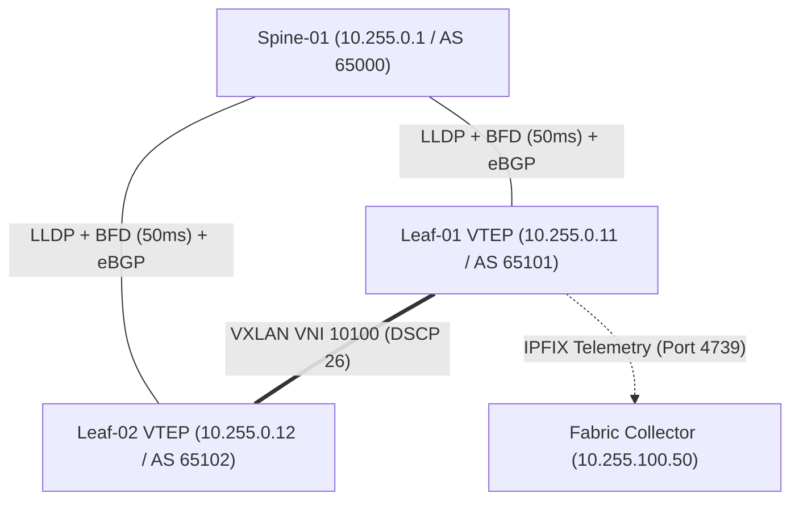

# FrameAssembly Multi-Protocol Enterprise Topologies, Overlays & Dual-Stack Scenarios

This guide showcases end-to-end, multi-layer network topologies written in [**FrameAssembly**](https://github.com/SteveWinschel/FrameAssembly) (`.fasm`) and stored across the **104 multi-protocol scenarios in `examples/topologies/`**. Each topology combines Layer 2 switching (`VLAN`, `QINQ`, `MPLS`, `LACP`, `LLDP`, `STP`, `EAPOL`), Layer 3 routing and tunneling (`OSPF`, `BGP`, `BFD`, `VRRP`, `GRE`, `VXLAN`, `GENEVE`, `ESP`, `AH`, `IKEV2`, `WIREGUARD`), Layer 4 stateful transport (`TCP`, `UDP`, `SCTP`), and Layer 7 application payloads (`DNS`, `DHCP`, `HTTP`, `HTTP2`, `GRPC`, `TLS`, `QUIC`, `SNMP3`, `NETFLOW`, `IPFIX`, `SYSLOG`, `POSTGRES`, `REDIS`, `AMQP`, `MODBUS`, `DNP3`, `S7COMM`, `ETHERNETIP`, `OPCUA`) with deterministic `WAIT` timing, multi-host `FLOW` orchestration, polymorphic IPv4/IPv6 reuse, and `LOOP` burst generation.

---

## 1. Architectural Patterns for Multi-Tier Topologies

FrameAssembly provides three core language mechanisms for composing complex network topologies:

1. **Multi-Parameter `FLOW` Blocks**: A `FLOW` block accepts an arbitrary number of formal endpoint parameters (`FLOW name(client, waf, app, db, cache, siem)`), allowing a single logical workflow to orchestrate lateral movement, proxy forwarding, East-West microservice RPCs, and out-of-band telemetry across 3 to 8 distinct hosts.
2. **Polymorphic IPv4 / IPv6 `FLOW` Reuse**: Because `FLOW` blocks do not hardcode IP families, the exact same `FLOW` can be invoked inside `COMPILE { ... }` first with IPv4 `HOST` declarations and immediately afterward with IPv6 `HOST` declarations, automatically switching between EtherType `0x0800` (IPv4 + ICMPv4) and EtherType `0x86DD` (IPv6 + ICMPv6) and computing the appropriate pseudo-header checksums.
3. **Deterministic `WAIT` Timing & `LOOP <count>` Bursts**: Every statement supports nanosecond-to-second timestamp advances (`WAIT 250us`, `WAIT 5ms`, `WAIT 1s`), and `COMPILE` blocks support `LOOP <count> { ... }` to synthesize realistic telemetry bursts, keepalive heartbeats, and DDoS/scan patterns.

| Topology Archetype | Representative Protocols Combined | Canonical Example Files in `examples/topologies/` |
| :--- | :--- | :--- |
| **EVPN-VXLAN Leaf-Spine Data Center Fabric** | `LLDP`, `LACP`, `BFD`, `BGP`, `VXLAN`, `IPFIX`, `SNMP3` | `topology_evpn_vxlan_leaf_spine_dc.fasm`, `topology_dc_spine_leaf_bgp_vxlan.fasm` |
| **Zero-Trust Campus 802.1X NAC Onboarding** | `EAPOL`, `RADIUS`, `VLAN`, `DHCP`, `ARP`, `DNS`, `SNMP3` | `topology_zero_trust_8021x_eapol_radius_dhcp_dns_arp_coa.fasm` |
| **Kubernetes Dual-Stack Service Mesh** | `DNS`, `TCP`, `TLS`, `HTTP2`, `GRPC`, `REDIS`, `POSTGRES`, `IPFIX` | `topology_k8s_dual_stack_service_mesh.fasm`, `topology_cloud_microservices_mesh.fasm` |
| **Carrier MPLS L3VPN & Segment Routing** | `LLDP`, `LACP`, `OSPF`, `BGP`, `BFD`, `MPLS`, `ICMP` | `topology_carrier_mpls_l3vpn_lacp_lldp_ospf_bgp_bfd_frr.fasm` |
| **Site-to-Site IPsec & WireGuard SD-WAN** | `IKEV2`, `ESP`, `AH`, `GRE`, `OSPF`, `BFD`, `WIREGUARD`, `VRRP` | `topology_wan_ipsec_ikev2_esp_ah_ospf.fasm`, `topology_sdwan_bfd_failover.fasm` |
| **5G SBA Core & Telco Signaling** | `SCTP`, `HTTP2`, `GRPC`, `TLS`, `QUIC`, `SIP`, `RTP` | `topology_5g_core_gtpu_sctp_http2.fasm`, `topology_5g_upf_pfcp_gtp_http2_sctp_diameter.fasm` |
| **IEC 62443 Substation & Factory OT** | `VLAN`, `MODBUS`, `DNP3`, `BACNET`, `S7COMM`, `ETHERNETIP`, `OPCUA`, `SYSLOG` | `topology_substation_iec62443_modbus_dnp3_s7comm_opcua_syslog.fasm` |
| **SOC Intrusion Detection & Threat Hunting** | `TCP`, `ICMP`, `DNS`, `HTTP`, `SMB`, `LDAP`, `KERBEROS`, `SYSLOG`, `NETFLOW` | `topology_soc_ransomware_lateral_smb_ldap_kerberos_dns_syslog.fasm` |

---

## 2. Data Center EVPN-VXLAN Leaf-Spine Clos Fabric (`LLDP` + `BFD` + `BGP` + `VXLAN` + `IPFIX`)

In modern cloud data centers, Spine-Leaf Clos topologies eliminate Spanning Tree bottlenecks by deploying equal-cost multi-path (ECMP) routing over an eBGP underlay, sub-second BFD failure detection, VXLAN tenant overlays (`UDP 4789`), and continuous IPFIX (`UDP 4739`) flow telemetry.



```frameassembly
// PROMPT: EVPN-VXLAN Leaf-Spine data center fabric with LLDP neighbor discovery, BFD sub-second liveness, eBGP underlay peering, VXLAN overlay burst, and IPFIX telemetry export.
// TOKENS: HOST, IP, MAC, FLOW, ->, <-, LLDP, CHASSIS_ID, PORT_ID, TTL, SYSNAME, BFD, STATE, MY_DISC, YOUR_DISC, MIN_TX, MIN_RX, MULT, BGP, OPEN, KEEPALIVE, UPDATE, ASN, HOLDTIME, BGPID, PREFIX, NEXTHOP, VXLAN, VNI, DSCP, PAYLOAD, IPFIX, SEQ, DOMAIN_ID, SRCIP, DSTIP, PROTO, PACKETS, OCTETS, WAIT, COMPILE, LOOP

// INSTRUCTION: Define the Spine router, two Leaf VTEP switches, and the fabric IPFIX telemetry collector.
HOST spine_01  {
    IP 10.255.0.1
    MAC 00:1c:73:00:00:01
}

// INSTRUCTION: Define Leaf-01 VTEP switch with IP 10.255.0.11.
HOST leaf_01   {
    IP 10.255.0.11
    MAC 00:1c:73:00:01:01
}

// INSTRUCTION: Define Leaf-02 VTEP switch with IP 10.255.0.12.
HOST leaf_02   {
    IP 10.255.0.12
    MAC 00:1c:73:00:01:02
}

// INSTRUCTION: Define the fabric observability IPFIX collector with IP 10.255.100.50.
HOST collector {
    IP 10.255.100.50
    MAC 00:1c:73:00:99:50
}

// INSTRUCTION: Bring up the Leaf-Spine underlay using LLDP, sub-second BFD, and eBGP route exchange.
FLOW underlay_bringup(spine, leaf) {
    // 1. L2 Link Layer Discovery Protocol (LLDP)
    spine -> leaf LLDP CHASSIS_ID "spine-01.dc1" PORT_ID "Ethernet1/1" TTL 120 SYSNAME "spine-01"
    spine <- leaf LLDP CHASSIS_ID "leaf-01.dc1" PORT_ID "Ethernet49/1" TTL 120 SYSNAME "leaf-01" WAIT 2ms

    // 2. Sub-Second Bidirectional Forwarding Detection (BFD)
    spine <- leaf BFD STATE 3 MY_DISC 101 YOUR_DISC 1 MIN_TX 50000 MIN_RX 50000 MULT 3 WAIT 5ms
    spine -> leaf BFD STATE 3 MY_DISC 1 YOUR_DISC 101 MIN_TX 50000 MIN_RX 50000 MULT 3 WAIT 2ms

    // 3. eBGP Underlay Peering and VTEP Loopback Advertisement
    spine <- leaf BGP OPEN ASN 65101 HOLDTIME 90 BGPID 10.255.0.11 WAIT 5ms
    spine -> leaf BGP OPEN ASN 65000 HOLDTIME 90 BGPID 10.255.0.1 WAIT 2ms
    spine <- leaf BGP KEEPALIVE WAIT 2ms
    spine -> leaf BGP KEEPALIVE WAIT 2ms
    spine <- leaf BGP UPDATE ASN 65101 PREFIX "10.254.1.1/32" NEXTHOP 10.255.0.11 WAIT 5ms
}

// INSTRUCTION: Encapsulate East-West tenant traffic inside VXLAN VNI 10100 with DSCP AF31 (26).
FLOW vxlan_east_west_burst(vtep1, vtep2) {
    vtep1 -> vtep2 VXLAN VNI 10100 DSCP 26 PAYLOAD "East-West Microservice RPC Frame" WAIT 2ms
}

// INSTRUCTION: Export aggregated fabric flow telemetry to the central IPFIX collector.
FLOW export_fabric_telemetry(leaf, col) {
    leaf -> col IPFIX SEQ 1 DOMAIN_ID 100 SRCIP 10.255.0.11 DSTIP 10.255.0.12 PROTO 17 PACKETS 4 OCTETS 512
}

// INSTRUCTION: Compile the underlay bring-up, 4-packet VXLAN burst, and IPFIX export.
COMPILE {
    underlay_bringup(spine_01, leaf_01)
    LOOP 4 {
        vxlan_east_west_burst(leaf_01, leaf_02)
    }
    export_fabric_telemetry(leaf_01, collector)
}
```

---

## 3. Campus Zero-Trust 802.1X NAC, RADIUS AAA, DHCP Lease & SNMPv3 Audit

Models an enterprise workstation connecting to a campus access switch port: IEEE 802.1X EAPOL supplicant authentication, RADIUS `ACCESS_REQUEST` / `ACCESS_ACCEPT` verification, dynamic VLAN assignment, DHCPv4 DORA lease acquisition, Gratuitous ARP duplicate address defense, and encrypted SNMPv3 USM `authPriv` compliance reporting.

```frameassembly
// PROMPT: Enterprise campus zero-trust 802.1X NAC onboarding combining EAPOL supplicant authentication, RADIUS AAA verification, DHCPv4 lease assignment, Gratuitous ARP, and SNMPv3 USM authPriv audit.
// TOKENS: HOST, IP, MAC, FLOW, ->, <-, EAPOL, VERSION, TYPE, START, EAP_PACKET, EAP_CODE, EAP_ID, EAP_METHOD, IDENTITY, RADIUS, ACCESS_REQUEST, ACCESS_ACCEPT, ID, USER, NAS_IP, FRAMED_IP, DHCP, DISCOVER, OFFER, REQUEST, ACK, TXID, CHADDR, YIADDR, SIADDR, SUBNET_MASK, ROUTER, DNS_SERVER, LEASE_TIME, ARP, GRATUITOUS, SHA, SPA, TPA, SNMP3, INFORM, ENGINEID, ENGINEBOOTS, ENGINETIME, AUTH, SHA256, PRIV, AES, REQID, VARBIND, STRING, INT, WAIT, COMPILE

// INSTRUCTION: Define the corporate supplicant workstation, campus access switch, RADIUS AAA server, and NMS compliance server.
HOST workstation {
    IP 10.10.50.100
    MAC 00:22:44:66:88:aa
}

// INSTRUCTION: Define the 802.1X authenticator access switch with IP 10.10.50.1.
HOST access_sw {
    IP 10.10.50.1
    MAC 00:11:22:33:44:01
}

// INSTRUCTION: Define the FreeRADIUS / ISE authentication server with IP 10.10.1.10.
HOST radius_srv {
    IP 10.10.1.10
    MAC 00:11:22:33:44:10
}

// INSTRUCTION: Define the Network Management System (NMS) compliance server with IP 10.10.1.20.
HOST nms_srv {
    IP 10.10.1.20
    MAC 00:11:22:33:44:20
}

// INSTRUCTION: Orchestrate 802.1X EAPOL onboarding, RADIUS verification, DHCPv4 DORA lease, Gratuitous ARP, and SNMPv3 Inform.
FLOW campus_dot1x_onboarding(ws, sw, aaa, nms) {
    // Step 1: IEEE 802.1X Supplicant EAPOL-Start & Identity Response
    ws -> sw EAPOL VERSION 2 TYPE START
    ws <- sw EAPOL VERSION 2 TYPE EAP_PACKET EAP_CODE 1 EAP_ID 1 EAP_METHOD 1 WAIT 5ms
    ws -> sw EAPOL VERSION 2 TYPE EAP_PACKET EAP_CODE 2 EAP_ID 1 EAP_METHOD 1 IDENTITY "eng-laptop-42" WAIT 5ms

    // Step 2: Switch Relays Credentials via RADIUS Access-Request & Receives Access-Accept
    sw -> aaa RADIUS ACCESS_REQUEST ID 42 USER "eng-laptop-42" NAS_IP 10.10.50.1 WAIT 5ms
    sw <- aaa RADIUS ACCESS_ACCEPT ID 42 FRAMED_IP 10.10.50.100 WAIT 5ms

    // Step 3: Switch Sends EAP-Success & Assigns DHCPv4 Lease via DORA
    ws <- sw EAPOL VERSION 2 TYPE EAP_PACKET EAP_CODE 3 EAP_ID 1 WAIT 5ms
    ws -> sw DHCP DISCOVER TXID 0xabcdef01 CHADDR 00:22:44:66:88:aa WAIT 5ms
    ws <- sw DHCP OFFER TXID 0xabcdef01 CHADDR 00:22:44:66:88:aa YIADDR 10.10.50.100 SIADDR 10.10.50.1 SUBNET_MASK 255.255.255.0 ROUTER 10.10.50.1 DNS_SERVER 10.10.1.53 LEASE_TIME 43200 WAIT 5ms
    ws -> sw DHCP REQUEST TXID 0xabcdef01 CHADDR 00:22:44:66:88:aa YIADDR 10.10.50.100 SIADDR 10.10.50.1 WAIT 5ms
    ws <- sw DHCP ACK TXID 0xabcdef01 CHADDR 00:22:44:66:88:aa YIADDR 10.10.50.100 SIADDR 10.10.50.1 SUBNET_MASK 255.255.255.0 ROUTER 10.10.50.1 DNS_SERVER 10.10.1.53 LEASE_TIME 43200 WAIT 10ms

    // Step 4: Workstation Sends Gratuitous ARP Announcement (RFC 5227)
    ws -> sw ARP GRATUITOUS SHA 00:22:44:66:88:aa SPA 10.10.50.100 TPA 10.10.50.100 WAIT 2ms

    // Step 5: SNMPv3 USM authPriv (HMAC-SHA256 + AES) Audit Notification to NMS
    sw -> nms SNMP3 INFORM USER "nac_auditor" ENGINEID "80001f88801122334455" ENGINEBOOTS 5 ENGINETIME 3600 AUTH SHA256 "AuditAuthKey2026!" PRIV AES "AuditPrivKey2026!" REQID 500 VARBIND 1.3.6.1.2.1.1.5.0 STRING "access-sw-floor2" VARBIND 1.3.6.1.2.1.2.2.1.8.12 INT 1
}

// INSTRUCTION: Compile the campus 802.1X NAC onboarding topology.
COMPILE {
    campus_dot1x_onboarding(workstation, access_sw, radius_srv, nms_srv)
}
```

---

## 4. Polymorphic Dual-Stack Cloud Microservice Mesh (`DNS` + `TLS` + `GRPC` + `REDIS` + `POSTGRES`)

Demonstrates how a **single parameterized `FLOW`** can orchestrate a complete 4-tier cloud-native microservice transaction (CoreDNS service discovery $\rightarrow$ Envoy mTLS 1.3 handshake $\rightarrow$ gRPC RPC $\rightarrow$ Redis cache lookup $\rightarrow$ PostgreSQL database query) and be compiled across **both IPv4 and IPv6 cluster networks** without duplicating a single line of flow logic:

```frameassembly
// PROMPT: Polymorphic dual-stack Kubernetes service mesh flow executing CoreDNS resolution, TLS 1.3 handshake, gRPC call, Redis cache check, and PostgreSQL query over both IPv4 and IPv6.
// TOKENS: HOST, IP, FLOW, ->, <-, DNS, QUERY, RESPONSE, QTYPE, RDATA, TXID, TCP, SYN, ACK, DSTPORT, TLS, CLIENT_HELLO, SERVER_HELLO, SNI, CIPHERSUITE, GRPC, PATH, STATUS, MSG, REDIS, CMD, KEY, ARGS, POSTGRES, WAIT, COMPILE

// INSTRUCTION: Define IPv4 Kubernetes Pod and Service endpoints.
HOST ingress_v4  { IP 10.244.1.10 }
HOST coredns_v4  { IP 10.96.0.10 }
HOST order_v4    { IP 10.244.2.20 }
HOST data_v4     { IP 10.244.3.30 }

// INSTRUCTION: Define IPv6 Kubernetes Pod and Service endpoints.
HOST ingress_v6  { IP fd00:10:244:1::10 }
HOST coredns_v6  { IP fd00:10:96::10 }
HOST order_v6    { IP fd00:10:244:2::20 }
HOST data_v6     { IP fd00:10:244:3::30 }

// INSTRUCTION: Define a polymorphic 4-host microservice flow reused identically for IPv4 and IPv6.
FLOW k8s_microservice_transaction(gw, dns, svc, db) {
    // 1. CoreDNS Service Discovery
    gw -> dns DNS QUERY TXID 901 QNAME "orders.prod.svc.cluster.local" QTYPE "A"
    gw <- dns DNS RESPONSE TXID 901 QNAME "orders.prod.svc.cluster.local" QTYPE "A" RDATA "10.244.2.20" WAIT 1ms

    // 2. Envoy Sidecar TCP + TLS 1.3 mTLS Handshake + gRPC Invocation
    gw -> svc TCP SYN DSTPORT 50051 WAIT 1ms
    gw <- svc TCP SYN ACK WAIT 1ms
    gw -> svc TCP ACK WAIT 1ms
    gw -> svc TLS CLIENT_HELLO SNI "orders.prod.svc.cluster.local" CIPHERSUITE 0x1301 WAIT 2ms
    gw <- svc TLS SERVER_HELLO CIPHERSUITE 0x1301 WAIT 2ms
    gw -> svc GRPC PATH "/commerce.OrderService/CreateOrder" MSG "sku=NVME-4TB&qty=2" WAIT 2ms

    // 3. Backend Service Queries Redis Cache & PostgreSQL Database
    svc -> db REDIS CMD "GET" KEY "inventory:NVME-4TB" WAIT 1ms
    svc <- db REDIS ARGS "42" WAIT 1ms
    svc -> db POSTGRES SQL "INSERT INTO orders (sku, qty) VALUES ('NVME-4TB', 2) RETURNING id;" WAIT 2ms
    svc <- db POSTGRES COMMAND_COMPLETE READY_FOR_QUERY PAYLOAD "INSERT 0 1" WAIT 2ms

    // 4. gRPC Status 0 (OK) Returned to API Gateway
    gw <- svc GRPC PATH "/commerce.OrderService/CreateOrder" STATUS 0 MSG "order_id=90042" WAIT 1ms
}

// INSTRUCTION: Compile the microservice mesh flow across both IPv4 and IPv6 cluster fabrics.
COMPILE {
    k8s_microservice_transaction(ingress_v4, coredns_v4, order_v4, data_v4)
    k8s_microservice_transaction(ingress_v6, coredns_v6, order_v6, data_v6)
}
```

---

## 5. Enterprise VoIP QoS, Perimeter Firewall IDS & 5G / Industrial Convergence

Models a converged enterprise WAN edge handling:
1. **Perimeter DMZ Firewall & SOC SIEM Alerting**: External scanner probes TCP port `3306`, receives immediate `TCP RST ACK`, and triggers an RFC 5424 `SYSLOG` alert (`FACILITY 16 SEVERITY 1`) + `NETFLOW` v5 record to the SOC SIEM.
2. **Enterprise VoIP QoS Prioritization**: SIP call setup (`DSCP 26` / `AF31`) followed by a `LOOP 4` burst of real-time G.711 RTP audio frames tagged with Layer 2 IEEE 802.1Q `VLAN 200 PCP 5` and Layer 3 `DSCP 46` (`EF`) + `RTCP` Sender Report.

```frameassembly
// PROMPT: Converged enterprise security and VoIP QoS scenario combining DMZ firewall port-scan RST defense, Syslog and NetFlow v5 SOC alerting, and DSCP/802.1p prioritized SIP/RTP voice media.
// TOKENS: HOST, IP, MAC, FLOW, ->, <-, TCP, SYN, RST, ACK, SRCPORT, DSTPORT, SYSLOG, FACILITY, SEVERITY, MSG, NETFLOW, SRCIP, DSTIP, PROTO, PACKETS, OCTETS, SIP, INVITE, BYE, URI, FROM, TO, CALL_ID, CSEQ, STATUS, REASON, METHOD, DSCP, VLAN, PCP, RTP, PT, SEQ, TIMESTAMP, SSRC, PAYLOAD, WAIT, COMPILE, LOOP

// INSTRUCTION: Define external scanner, perimeter firewall, SOC SIEM server, VoIP desk phone, and IP PBX gateway.
HOST ext_scanner {
    IP 203.0.113.99
    MAC 00:0c:29:99:00:01
}

// INSTRUCTION: Define perimeter DMZ firewall with IP 198.51.100.1.
HOST edge_fw {
    IP 198.51.100.1
    MAC 00:1b:21:10:00:01
}

// INSTRUCTION: Define internal SOC SIEM & NetFlow collector with IP 10.50.1.100.
HOST soc_siem {
    IP 10.50.1.100
    MAC 00:50:56:50:01:64
}

// INSTRUCTION: Define executive VoIP telephone endpoint with IP 10.20.1.15.
HOST voip_phone {
    IP 10.20.1.15
    MAC 00:04:f2:20:01:0f
}

// INSTRUCTION: Define enterprise IP PBX media gateway with IP 10.20.1.1.
HOST ip_pbx {
    IP 10.20.1.1
    MAC 00:04:f2:20:01:01
}

// INSTRUCTION: Block unauthorized TCP SYN scan with RST ACK and emit Syslog + NetFlow v5 telemetry to SOC SIEM.
FLOW dmz_firewall_defense(att, fw, siem) {
    att -> fw TCP SYN SRCPORT 54321 DSTPORT 3306
    att <- fw TCP RST ACK SRCPORT 3306 DSTPORT 54321 WAIT 1ms
    fw -> siem SYSLOG FACILITY 16 SEVERITY 1 MSG "DROP IN=wan0 SRC=203.0.113.99 DST=198.51.100.1 DPT=3306 SYN" WAIT 2ms
    fw -> siem NETFLOW SRCIP 203.0.113.99 DSTIP 198.51.100.1 PROTO 6 PACKETS 1 OCTETS 60 WAIT 2ms
}

// INSTRUCTION: Establish a SIP voice call with DSCP 26 (AF31) signaling QoS.
FLOW voip_sip_setup(phone, pbx) {
    phone -> pbx DSCP 26 SIP INVITE URI "sip:bob@corp.example" FROM "sip:alice@corp.example" TO "sip:bob@corp.example" CALL_ID "call-8821@10.20.1.15" CSEQ 1
    phone <- pbx DSCP 26 SIP STATUS 200 REASON "OK" CALL_ID "call-8821@10.20.1.15" CSEQ 1 WAIT 5ms
    phone -> pbx DSCP 26 SIP METHOD "ACK" URI "sip:bob@corp.example" CALL_ID "call-8821@10.20.1.15" CSEQ 1 WAIT 2ms
}

// INSTRUCTION: Stream high-priority RTP G.711 voice frames with 802.1Q VLAN 200 PCP 5 and DSCP 46 (EF).
FLOW voip_rtp_media_burst(phone, pbx) {
    phone -> pbx VLAN 200 PCP 5 DSCP 46 RTP PT 0 SEQ 100 TIMESTAMP 160 SSRC 0x12345678 PAYLOAD "G711_PCMU_20MS_VOICE_FRAME" WAIT 20ms
}

// INSTRUCTION: Gracefully terminate the SIP call with BYE and 200 OK.
FLOW voip_sip_teardown(phone, pbx) {
    phone -> pbx DSCP 26 SIP BYE URI "sip:bob@corp.example" CALL_ID "call-8821@10.20.1.15" CSEQ 2
    phone <- pbx DSCP 26 SIP STATUS 200 REASON "OK" CALL_ID "call-8821@10.20.1.15" CSEQ 2 WAIT 2ms
}

// INSTRUCTION: Compile the DMZ intrusion defense and QoS-prioritized VoIP call lifecycle.
COMPILE {
    dmz_firewall_defense(ext_scanner, edge_fw, soc_siem)
    voip_sip_setup(voip_phone, ip_pbx)
    LOOP 4 {
        voip_rtp_media_burst(voip_phone, ip_pbx)
    }
    voip_sip_teardown(voip_phone, ip_pbx)
}
```

---

## 6. IEC 62443 Substation & Industrial Purdue OT Zone Conduit (`MODBUS` + `DNP3` + `S7COMM` + `OPCUA` + `SYSLOG`)

Models an electrical utility substation segmented according to IEC 62443 / Purdue Enterprise Reference Architecture (Levels 1–3.5), combining IEEE 802.1Q `VLAN 110 PCP 6` priority-tagged Modbus TCP, DNP3 Class 0 polling, Siemens S7comm PLC diagnostics, and OPC UA + Syslog export across the Industrial DMZ (`VLAN 120`):

```frameassembly
// PROMPT: IEC 62443 utility substation security zone combining Modbus TCP, DNP3 outstation polling, S7comm PLC diagnostics, OPC UA historian push, and Syslog SIEM alerts.
// TOKENS: HOST, IP, MAC, FLOW, ->, <-, VLAN, PCP, MODBUS, UNITID, FUNC, ADDR, COUNT, IS_RESPONSE, WAIT, DNP3, SRC, DST, S7COMM, ROSCTR, PDU_REF, OPCUA, ENDPOINT_URL, NODE_ID, SYSLOG, FACILITY, SEVERITY, MSG, COMPILE

// INSTRUCTION: Define the Level 2 Substation SCADA HMI engineering master.
HOST substation_hmi {
    IP 172.22.10.5
    MAC 00:1b:21:22:0a:05
}

// INSTRUCTION: Define the Level 1 Bay Controller RTU speaking Modbus TCP and IEEE 1815 DNP3.
HOST bay_rtu_controller {
    IP 172.22.10.50
    MAC 00:a0:c9:22:0a:32
}

// INSTRUCTION: Define the Level 1 Transformer Protection PLC speaking Siemens S7comm.
HOST transformer_s7_plc {
    IP 172.22.10.60
    MAC 00:0e:8c:22:0a:3c
}

// INSTRUCTION: Define the Level 3.5 Industrial DMZ OPC UA Historian and Syslog SIEM collector.
HOST dmz_historian_siem {
    IP 172.22.20.100
    MAC 00:50:56:22:14:64
}

// INSTRUCTION: Poll bay RTU and transformer PLC across VLAN 110 (PCP 6) and push telemetry to the IDMZ over VLAN 120.
FLOW substation_iec62443_telemetry(hmi, rtu, plc, siem) {
    hmi -> rtu VLAN 110 PCP 6 MODBUS UNITID 1 FUNC "READ_HOLDING_REGISTERS" ADDR 40001 COUNT 8
    hmi <- rtu VLAN 110 PCP 6 MODBUS UNITID 1 FUNC "READ_HOLDING_REGISTERS" COUNT 8 IS_RESPONSE WAIT 1ms
    hmi -> rtu VLAN 110 PCP 6 DNP3 SRC 1 DST 10 FUNC "READ" WAIT 1ms
    hmi <- rtu VLAN 110 PCP 6 DNP3 SRC 10 DST 1 FUNC "RESPONSE" WAIT 1ms
    hmi -> plc VLAN 110 PCP 6 S7COMM ROSCTR "JOB" FUNC "READ_VAR" PDU_REF 10 WAIT 1ms
    hmi -> siem VLAN 120 PCP 4 OPCUA ENDPOINT_URL "opc.tcp://dmz-hist:4840" NODE_ID "ns=3;s=Feeder01.kV" WAIT 2ms
    hmi -> siem VLAN 120 PCP 4 SYSLOG FACILITY 4 SEVERITY 5 MSG "IEC62443-Conduit: Authorized SCADA poll completed" WAIT 1ms
}

// INSTRUCTION: Compile the IEC 62443 substation OT security conduit flow.
COMPILE {
    substation_iec62443_telemetry(substation_hmi, bay_rtu_controller, transformer_s7_plc, dmz_historian_siem)
}
```

---

## 7. Cross-References & Complete Topology Index (`examples/topologies/`)

All **104 multi-protocol `.fasm` topologies** in [`examples/topologies/`](../examples/topologies/) are verified during `cargo test` and cover:
- **Data Center & Cloud Fabrics**: `topology_evpn_vxlan_leaf_spine_dc.fasm`, `topology_dc_rocev2_pfc_ecn_bgp.fasm`, `topology_nvme_tcp_storage_san_vlan_lldp_bgp_bfd.fasm`
- **Service Provider & WAN**: `topology_carrier_mpls_l3vpn_lacp_lldp_ospf_bgp_bfd_frr.fasm`, `topology_isp_broadband_bng_qinq_pppoe_radius_dns.fasm`, `topology_wan_ipsec_ikev2_esp_ah_ospf.fasm`, `topology_satcom_leo_ground_station_mpls_gre_ospf_bfd_snmpv3.fasm`
- **5G Mobile Core & VoIP**: `topology_5g_core_gtpu_sctp_http2.fasm`, `topology_5g_upf_pfcp_gtp_http2_sctp_diameter.fasm`, `topology_ims_volte_sip_diameter_rtp_rtcp_ipsec.fasm`
- **Industrial ICS / SCADA / OT**: `topology_substation_iec62443_modbus_dnp3_s7comm_opcua_syslog.fasm`, `topology_smart_grid_derms_dnp3_modbus_bacnet_ntp_ipfix.fasm`, `topology_purdue_ics_s7comm_eip_opcua.fasm`
- **Enterprise Security & Threat Hunting**: `topology_zero_trust_8021x_eapol_radius_dhcp_dns_arp_coa.fasm`, `topology_soc_ransomware_lateral_smb_ldap_kerberos_dns_syslog.fasm`, `topology_ddos_mitigation_gre_bgp_netflow_sflow_icmp.fasm`

